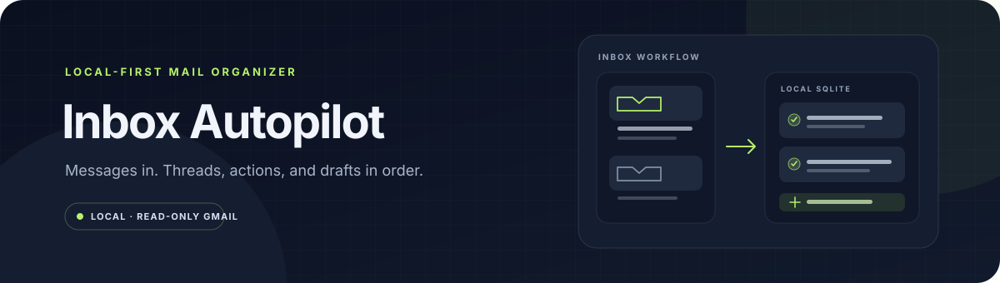
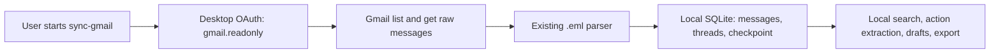

# Inbox Autopilot



[](https://github.com/jezannn16/inbox-autopilot/actions/workflows/ci.yml)
[](https://www.python.org/)

**A local-first inbox organizer for `.eml` files and Gmail.** Search messages, group threads, extract explicitly marked actions, and keep reply drafts in SQLite. Gmail access uses a desktop OAuth flow requesting read-only scope; email is never sent or changed.

| | |
|---|---|
| **Mail sources** | Local `.eml` files and Gmail read-only sync |
| **Data location** | Local SQLite database; OAuth files in your user config directory |
| **Network use** | Gmail API only when you run `sync-gmail` |
| **Writes to Gmail** | None |

## Contents

- [Quick start](#quick-start)
- [Gmail setup](#gmail-setup)
- [What happens during sync](#what-happens-during-sync)
- [Commands](#commands)
- [Privacy and limits](#privacy-and-limits)
- [Development](#development)

## Quick start

Python 3.11 or newer is required. Install the project in an isolated environment:

```sh
python3 -m venv .venv
.venv/bin/python -m pip install -e .
```

Try the checked-in synthetic email. The database is created beside the command unless `--db` points elsewhere:

```sh
.venv/bin/python app.py --db /tmp/inbox-demo.sqlite3 import fixtures/sample.eml
.venv/bin/python app.py --db /tmp/inbox-demo.sqlite3 list --query project
.venv/bin/python app.py --db /tmp/inbox-demo.sqlite3 extract 1
.venv/bin/python app.py --db /tmp/inbox-demo.sqlite3 draft 1 --suggest
```

The fixture has a `TODO:` line with an explicit owner and due date. Importing the same file again reports `imported: false`. Drafts stay in the local database.

## Gmail setup

Gmail sync is optional. Install the Gmail client libraries with the project extra:

```sh
.venv/bin/python -m pip install -e '.[gmail]'
```

The application asks Google only for `https://www.googleapis.com/auth/gmail.readonly`; its adapter calls message-list and message-get operations and has no send, delete, label, or mailbox-update method. This scope lets the app read mail, so keep the local token private.

1. In a Google Cloud project you control, enable the Gmail API and configure the OAuth consent screen. For a personal test, use the testing audience and add your own Google account as a test user.
2. Create an OAuth client with application type **Desktop app** and download its JSON file. These are user-created Google Cloud settings; this repository does not create cloud resources.
3. Store the downloaded file outside this checkout at `~/.config/inbox-autopilot/credentials.json`. Do not commit it or paste its contents into chat. The generated token is written to `~/.config/inbox-autopilot/token.json` with owner-only file permissions.
4. Run a small sync first:

   ```sh
   .venv/bin/python app.py --db /tmp/inbox-gmail-test.sqlite3 sync-gmail --query 'in:inbox newer_than:7d' --max-pages 1
   .venv/bin/python app.py --db /tmp/inbox-gmail-test.sqlite3 list
   ```

The first run opens a browser for Google consent and returns to a temporary loopback server on your computer. Gmail messages are fetched as RFC 822 data and passed through the same parser as local `.eml` imports. Sync processes at most 100 messages per page and 10 pages by default; use `--max-pages` to change that per-run ceiling. The saved page checkpoint lets a later run continue if the ceiling is reached. Repeated messages are deduplicated locally.

Google classifies `gmail.readonly` as a restricted scope. Google may show an unverified-app warning during personal testing, and a public application using this scope may require Google's OAuth verification and policy review. A project left in External / Testing has time-limited grants that expire after seven days, so reauthorization may be needed. See [Gmail API Python quickstart](https://developers.google.com/workspace/gmail/api/quickstart/python), [Gmail API scopes](https://developers.google.com/workspace/gmail/api/auth/scopes), and [Google OAuth testing status](https://support.google.com/cloud/answer/15549945?hl=en).

## What happens during sync



The diagram shows the implemented path: OAuth and Gmail reads happen only after an explicit command; parsing, storage, search, and drafts run locally. No reply or mailbox mutation is part of this flow.

## Commands

```sh
# Import a local RFC 822 message.
.venv/bin/python app.py --db inbox.sqlite3 import fixtures/sample.eml

# Search sender and subject, then inspect explicitly marked actions.
.venv/bin/python app.py --db inbox.sqlite3 list --query project
.venv/bin/python app.py --db inbox.sqlite3 extract 1

# Save a human-reviewed draft locally; this never sends it.
.venv/bin/python app.py --db inbox.sqlite3 draft 1 --suggest

# Export local messages to CSV.
.venv/bin/python app.py --db inbox.sqlite3 export messages.csv
```

`extract` recognizes action language only on explicitly marked lines such as `TODO:`, `ACTION:`, `нужно:` or `прошу:`. Owner and date are recorded only when written on the same evidence line. The confidence field is a fixed baseline marker, not a calibrated probability.

## Privacy and limits

- SQLite stores full plain-text message bodies. Choose a protected local path and handle backups/exports as private email data.
- Attachments are ignored by the parser; they are never executed. Gmail raw messages are fetched for parsing, but attachment parts are excluded from the stored body.
- Gmail sync is read-only and limited to Gmail. There is no IMAP adapter, automatic background sync, LLM, or sending feature.
- The OAuth refresh token is a credential. Keep `credentials.json` and `token.json` outside Git, restrict access to your account, and revoke the app's Google Account access when it is no longer needed.
- Action extraction is deterministic and should be checked against its source message.

## Development

Run the offline and mocked provider tests and Ruff locally:

```sh
.venv/bin/python -m unittest discover -v
ruff check .
```

CI runs those checks on Python 3.11 and 3.13. The Gmail adapter tests use a synthetic RFC 822 fixture and a fake API service; no Google account or live credentials are needed for CI.

For the original `.eml` walkthrough, see [docs/demo.md](docs/demo.md). The CLI also lists options with `app.py --help`.
