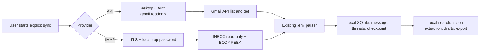

# Inbox Autopilot


[](https://github.com/jezannn16/inbox-autopilot/actions/workflows/ci.yml)
[](https://www.python.org/)

**A local-first inbox organizer for `.eml` files and Gmail.** Search messages, group threads, extract explicitly marked actions, and keep reply drafts in SQLite. Gmail sync is explicit and read-only; choose API OAuth or IMAP app-password authentication.

| | |
|---|---|
| **Mail sources** | Local `.eml` files and Gmail read-only sync |
| **Data location** | Local SQLite database; API OAuth files stay in your user config directory; IMAP app passwords are entered locally and not saved |
| **Network use** | Gmail only when you run `sync-gmail` or `sync-gmail-imap` |
| **Writes to Gmail** | None |

## Contents

- [Quick start](#quick-start)
- [Gmail setup](#gmail-setup)
- [What happens during sync](#what-happens-during-sync)
- [Commands](#commands)
- [Privacy and limits](#privacy-and-limits)
- [Development](#development)

## Quick start

Python 3.11 or newer is required. Check that `python3 --version` reports a supported version; if your system's `python3` is older, use the explicit path to an installed Python 3.11+ executable in the venv command. Install the project in an isolated environment:

```sh
python3 -m venv .venv
.venv/bin/python -m pip install --upgrade pip
.venv/bin/python -m pip install -e .
```

Try the checked-in synthetic email. The database is created beside the command unless `--db` points elsewhere:

```sh
.venv/bin/python app.py --db /tmp/inbox-demo.sqlite3 import fixtures/sample.eml
.venv/bin/python app.py --db /tmp/inbox-demo.sqlite3 list --query project
.venv/bin/python app.py --db /tmp/inbox-demo.sqlite3 list --query timeline --sender example.test --since 2026-10-01 --has-actions
.venv/bin/python app.py --db /tmp/inbox-demo.sqlite3 extract 1
.venv/bin/python app.py --db /tmp/inbox-demo.sqlite3 actions
.venv/bin/python app.py --db /tmp/inbox-demo.sqlite3 summary 1
.venv/bin/python app.py --db /tmp/inbox-demo.sqlite3 draft 1 --suggest
.venv/bin/python app.py --db /tmp/inbox-demo.sqlite3 drafts
.venv/bin/python app.py --db /tmp/inbox-demo.sqlite3 export /tmp/inbox-export.json --format json
```

The fixture has a `TODO:` line with an explicit owner and due date. Importing the same file again reports `imported: false`. `summary` gives an extractive message summary and already-recorded explicit actions. Suggested drafts include a short excerpt from the source in English or Russian and remain local for human review.

`list` searches message body, sender, subject, and Message-ID. Combine `--sender`, `--subject`, inclusive `--since YYYY-MM-DD` / `--until YYYY-MM-DD`, `--has-actions`, and `--limit` (1–500) to narrow results. A mail `Date` header without an offset is interpreted as UTC; absent or malformed dates remain empty. Extracted due dates are recorded only when they form a real calendar date; the original evidence remains visible even when a stated date is invalid.

## Gmail setup

### IMAP app password (no Cloud project)

This path uses Gmail's IMAP service directly, so it does not create a Google Cloud project or Gmail API OAuth client or billing setup. For personal Google Accounts, IMAP access has been on by default since January 2025; Google says no manual IMAP toggle is needed. Google recommends “Sign in with Google” where available and describes app passwords as less secure, so use a dedicated Google **App password**, never your normal account password:

1. Turn on 2-Step Verification for the Google Account, then create an app password from Google Account security settings. App passwords are only available to eligible accounts. Google may hide this option for security-key-only 2-Step Verification, Advanced Protection, or work/school accounts controlled by an organization. Changing the main Google Account password revokes app passwords.
2. Run the command below. The password prompt is hidden in the local terminal and the app does not save it. Alternatively, provide `GMAIL_IMAP_USERNAME` and `GMAIL_IMAP_APP_PASSWORD` in the process environment; avoid putting secrets in shell history or the repository.

   ```sh
   GMAIL_IMAP_USERNAME='you@gmail.com' .venv/bin/python app.py --db /tmp/inbox-imap.sqlite3 sync-gmail-imap --prompt-password
   .venv/bin/python app.py --db /tmp/inbox-imap.sqlite3 list
   ```

The adapter connects to `imap.gmail.com:993` with certificate-checked TLS, opens `INBOX` read-only, and fetches message bodies with `BODY.PEEK[]`. It has no append, store, copy, delete, expunge, or send operation. It imports the 1000 most recent UID positions on first sync (up to 50 messages per page), persists `UIDVALIDITY`/UID checkpoints, and deduplicates using the existing message ID and content fingerprint. Later runs fetch newer UIDs. Only `INBOX` is synced; archived mail, Gmail labels, and remote deletions are not mirrored.

An app password is broader than Gmail API's server-enforced `gmail.readonly` OAuth scope: Google authorizes IMAP access, while this adapter enforces read-only operations in its implementation. Revoke the app password in Google Account security settings when it is no longer needed. See Google's [Gmail IMAP guidance](https://support.google.com/mail/answer/7126229?hl=en), [IMAP client settings](https://support.google.com/mail/answer/78892?hl=en), and [App passwords requirements and limitations](https://support.google.com/accounts/answer/185833?hl=en).

### Gmail API OAuth

The API sync remains optional. Install the Gmail client libraries with the project extra:

```sh
.venv/bin/python -m pip install -e '.[gmail]'
```

The API path asks Google only for `https://www.googleapis.com/auth/gmail.readonly`; it requires a user-configured Cloud project and OAuth client. This scope lets the app read mail, so keep the local token private. Gmail API requests use TLS with a 20-second HTTP timeout and the client library's bounded exponential retries (2 by default, configurable from 0 to 5 in the provider); sync still resumes through the persisted page token after a per-run page ceiling.

1. In a Google Cloud project you control, enable the Gmail API and configure the OAuth consent screen. For a personal test, use the testing audience and add your own Google account as a test user.
2. Create an OAuth client with application type **Desktop app** and download its JSON file. These are user-created Google Cloud settings; this repository does not create cloud resources.
3. Store the downloaded file outside this checkout at `~/.config/inbox-autopilot/credentials.json`. Do not commit it or paste its contents into chat. The generated token is written to `~/.config/inbox-autopilot/token.json` with owner-only file permissions.
4. Run a small sync first:

   ```sh
   .venv/bin/python app.py --db /tmp/inbox-gmail-test.sqlite3 sync-gmail --query 'in:inbox newer_than:7d' --max-pages 1
   .venv/bin/python app.py --db /tmp/inbox-gmail-test.sqlite3 list
   ```

The first run opens a browser for Google consent and returns to a temporary loopback server on your computer. Gmail messages are fetched as RFC 822 data and passed through the same parser as local `.eml` imports. Sync processes at most 100 messages per page and 10 pages by default; use `--max-pages` to change that per-run ceiling. The saved page checkpoint lets a later run continue if the ceiling is reached. Repeated messages are deduplicated locally.

Google classifies `gmail.readonly` as a restricted scope. Google may show an unverified-app warning during personal testing, and a public application using this scope may require Google's OAuth verification and policy review. A project left in External / Testing has time-limited grants that expire after seven days, so reauthorization may be needed. See [Gmail API Python quickstart](https://developers.google.com/workspace/gmail/api/quickstart/python), [Gmail API scopes](https://developers.google.com/workspace/gmail/api/auth/scopes), and [Google OAuth testing status](https://support.google.com/cloud/answer/15549945?hl=en).

## What happens during sync



Both remote paths start only after an explicit command; parsing, storage, search, and drafts run locally. No reply or mailbox mutation is part of either flow.

## Commands

```sh
# Import a local RFC 822 message.
.venv/bin/python app.py --db inbox.sqlite3 import fixtures/sample.eml

# Search sender and subject, then inspect explicitly marked actions.
.venv/bin/python app.py --db inbox.sqlite3 list --query project
.venv/bin/python app.py --db inbox.sqlite3 extract 1

# Save a human-reviewed draft locally; this never sends it.
.venv/bin/python app.py --db inbox.sqlite3 draft 1 --suggest

# Export local messages to CSV, or all local mail-related records to JSON.
.venv/bin/python app.py --db inbox.sqlite3 export messages.csv
.venv/bin/python app.py --db inbox.sqlite3 export inbox-export.json --format json

# Optional Gmail IMAP sync; requests the app password without echoing it.
GMAIL_IMAP_USERNAME='you@gmail.com' .venv/bin/python app.py --db inbox.sqlite3 sync-gmail-imap --prompt-password
```

`extract` recognizes action language only on explicitly marked lines such as `TODO:`, `ACTION:`, `нужно:` or `прошу:`. Owner and date are recorded only when written on the same evidence line. The confidence field is a fixed baseline marker, not a calibrated probability.

For a human-reviewed action, use `action-add MESSAGE_ID 'Action' --owner 'Name' --due YYYY-MM-DD --evidence 'Source excerpt'`. `actions` lists saved items with their source message ID, and `drafts` lists local drafts with their source thread key. Manual owner/date values are optional and validated; the app does not infer them.

## Privacy and limits

- SQLite stores full plain-text message bodies. Choose a protected local path and handle backups/exports as private email data. `export --format json` includes accounts, threads, messages, actions, drafts, and sync checkpoints; CSV remains a message-only export.
- `delete-all --confirm` removes all locally stored mail records and sync state. It does not revoke the separate Google OAuth grant or Gmail App password; revoke either in Google Account settings if needed.
- Attachments are ignored by the parser; they are never executed. Plain-text message bodies take precedence; HTML-only messages are converted locally to plain text, with script, style, head, and template content omitted. Gmail raw messages are fetched for parsing, but attachment parts are excluded from the stored body.
- Gmail sync is explicit and read-only. The IMAP app password is not stored in SQLite, but it grants the broader IMAP access Google documents; the adapter uses read-only mailbox selection and `BODY.PEEK`. There is no automatic background sync, LLM, or sending feature.
- The OAuth refresh token is a credential. Keep `credentials.json` and `token.json` outside Git, restrict access to your account, and revoke the app's Google Account access when it is no longer needed.
- Google can revoke App passwords when the account password changes; eligibility depends on account security settings and Workspace policy. If Google does not offer App passwords, use the API OAuth route or continue with `.eml` imports.
- Action extraction is deterministic and should be checked against its source message. Impossible stated dates are retained in evidence but not stored as due dates.
- Message summaries and suggested replies are extractive templates, not generated or verified answers. Check the full source before using a draft.

## Development

Install the development extra, then run the offline and mocked provider tests and Ruff:

```sh
.venv/bin/python -m pip install -e '.[dev]'
.venv/bin/python -m unittest discover -v
.venv/bin/ruff check .
```

CI runs those checks on Python 3.11 and 3.13. Gmail API and IMAP adapter tests use synthetic RFC 822 messages and fake transports; no Google account or live credentials are needed for CI.

For the original `.eml` walkthrough, see [docs/demo.md](docs/demo.md). The CLI also lists options with `app.py --help`.
